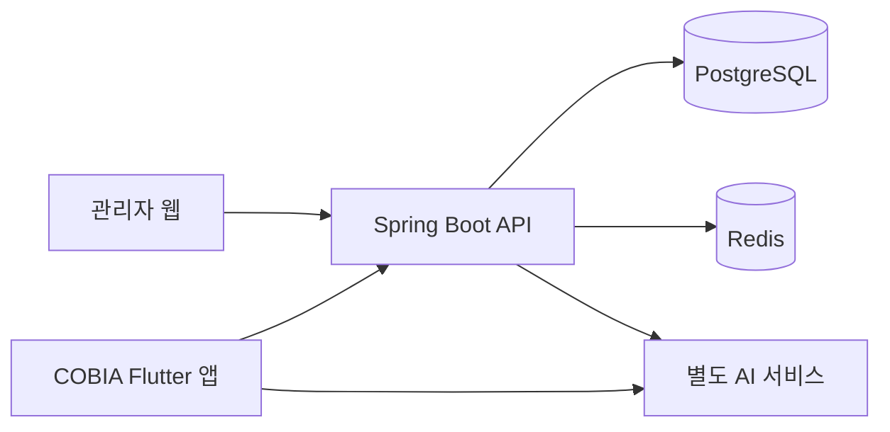

# COBIA 앱 백엔드

[COBIA Android 앱](https://github.com/COBIP-APP/COBIP_APP_FE)과 [관리자 웹](https://github.com/COBIP-APP/COBIP_APP_ADMIN)이 사용하는 Spring Boot API입니다. 이메일 인증·계정, 학습 콘텐츠, 문제 제출, 학습 진도, 북마크, 저장한 AI 생성 문제를 처리합니다. 학습 데이터는 PostgreSQL에, 만료가 필요한 인증 정보는 Redis에 저장합니다. AI 서비스는 별도로 실행합니다.

기존 COBIP 웹 서비스와 COBIA 앱은 별도의 백엔드와 DB를 사용합니다. 두 서비스의 계정·학습 데이터는 자동으로 공유되지 않습니다.



## 주요 기능

| 영역 | 기능 |
| --- | --- |
| 인증 | 이메일 인증, 회원가입·로그인, 토큰 재발급·로그아웃, 비밀번호 재설정 |
| 학습 | 언어·주제·챕터·목차·문제 조회, 답안 제출·최근 결과 조회 |
| 활동 기록 | 학습 위치·완료 상태, 북마크, 사용자별 생성 문제 저장·조회·삭제 |
| 관리자 | 언어·주제, 챕터·목차·문제 등록, 수정·공개·삭제 |
| AI 연동 | 백엔드에서 필요한 AI 요청을 별도 AI 서버로 전달하고 응답을 확인 |

## 시작 전에 준비할 것

아래는 **Windows PC에서 따라 하는 기준**입니다. 본인이 사용할 방법의 항목만 설치하면 됩니다.

| 목적 | 필요한 것 | 확인 방법 |
| --- | --- | --- |
| 로컬 백엔드 실행 | [Git for Windows](https://git-scm.com/install/windows), [Docker Desktop](https://docs.docker.com/desktop/setup/install/windows-install/) | PowerShell에서 `git --version`, `docker version`, `docker compose version` |
| Flutter 앱 화면 실행 | [Flutter SDK와 Android Studio](https://docs.flutter.dev/platform-integration/android/setup) | `flutter doctor -v`, `flutter devices` |
| 관리자 웹 실행 | [Node.js와 npm](https://nodejs.org/en/download/) | `node --version`, `npm --version` |
| 이메일 가입까지 시험 | 본인이 받을 수 있는 이메일, SMTP 발신 계정 |  인증 메일을 받을 수 있는지 확인 |
| 기존 배포 서버 사용 | 인터넷과 운영 중인 API 서버 | 아래 ‘이미 배포된 서버 사용’의 HTTPS 확인 |

PowerShell은 Windows 시작 메뉴에서 **Windows PowerShell**을 검색해 엽니다. `PS C:\...>`처럼 앞에 표시되는 프롬프트는 입력하지 않고 코드 블록 안의 명령만 한 줄씩 실행합니다. Docker Desktop은 설치 후 실행 상태가 될 때까지 기다립니다. Docker 설치 과정에서 WSL 2 설정이나 재시작을 요구하면 설치 안내에 따라 완료합니다.

**경로 선택:** 백엔드·DB·Redis를 자기 PC에서 따로 실행하며 데이터를 넣어 보고 싶다면 다음 ‘로컬 실행’을 따릅니다. 이미 운영 중인 서버로 앱을 빨리 시험하려면 ‘이미 배포된 서버 사용’으로 이동합니다. 두 방법은 서로 다른 DB를 사용합니다.

## 로컬 실행: Windows PowerShell + Docker Desktop

이 방법은 백엔드·PostgreSQL·Redis를 자신의 PC에서 실행합니다. Java와 PostgreSQL을 PC에 따로 설치하지 않습니다. 코드는 `develop` 브랜치를 기준으로 받습니다. 이미 같은 이름의 저장소 폴더가 있으면 다시 `git clone`하지 말고 그 폴더로 이동합니다.

```powershell
git clone --branch develop https://github.com/COBIP-APP/COBIP_APP_BE.git
cd COBIP_APP_BE
powershell -NoProfile -ExecutionPolicy Bypass -File .\setup-local.ps1
notepad .env
```

메모장에 열린 `.env`에서 `DB_PASSWORD=`의 오른쪽에 **본인이 정한 로컬 DB 비밀번호**를 입력하고 저장합니다. 예: `DB_PASSWORD=MyLocalDb_ChangeMe`(이 예시를 그대로 사용하지 마세요). `setup-local.ps1`은 `.env`와 `config/application-local.yml`이 없을 때만 생성하며, 로컬 JWT 키도 설정합니다. 비밀번호를 비워 두면 Compose가 시작되지 않습니다.

```powershell
docker compose config --quiet
docker compose --profile full up -d --build --wait
docker compose ps
curl.exe -s -o NUL -w "%{http_code}" http://127.0.0.1:8080/v3/api-docs
```

`docker compose config --quiet`은 설정이 맞으면 아무것도 출력하지 않습니다. `app`, `postgres`, `redis`가 실행 중이고 마지막 명령에서 `200`이 나오면 [Swagger UI](http://127.0.0.1:8080/swagger-ui/index.html)를 엽니다. 처음 빌드는 이미지 다운로드 때문에 시간이 걸릴 수 있습니다. Compose는 PostgreSQL 5432·Redis 6379·앱 8080을 PC의 `127.0.0.1`에 연결합니다.

이제 앱을 실행할 때 `API_BASE_URL=http://10.0.2.2:8080`을 지정하면 같은 PC의 Android 에뮬레이터에서 로컬 백엔드를 사용합니다. 관리자 웹은 기본 설정 그대로 이 로컬 백엔드에 연결됩니다. 로컬 가입 계정과 학습 데이터는 운영 서버에 나타나지 않습니다.

### 회원가입용 이메일 설정

회원가입 화면에서 실제 인증 메일을 받으려면 발신 계정의 SMTP 설정이 필요합니다. PowerShell에서 `notepad .\config\application-local.yml`을 실행하고 **기존** `spring.mail`과 `app.mail.from` 값을 채웁니다. `spring:` 또는 `app:` 블록을 새로 중복해서 붙이지 마세요.

```yaml
spring:
  mail:
    host: smtp.gmail.com
    port: 587
    username: 발신계정@gmail.com
    password: '발신계정의앱비밀번호'
    properties:
      mail.smtp.auth: true
      mail.smtp.starttls.enable: true

app:
  mail:
    from: 발신계정@gmail.com
```

Gmail 예시에서는 Google 계정의 2단계 인증을 켠 뒤 **앱 비밀번호**를 발급받아 사용합니다. Google 로그인 비밀번호를 넣지 않습니다. 설정을 저장한 뒤 `docker compose --profile full restart app`으로 앱을 다시 시작합니다. 발신 설정이 비어 있으면 서버는 실행되지만 메일 발송 API는 `503 MAIL_UNAVAILABLE`을 반환합니다. `.env`와 `config/application-local.yml`에는 비밀값이 있으므로 Git에 올리지 않습니다.

### Swagger에서 API를 직접 시험하기

Swagger UI가 열리는 것과 로그인 후 API가 동작하는 것은 별개입니다. 앱에서 이메일 인증·회원가입을 완료한 계정으로 아래 순서를 따라 확인할 수 있습니다.

1. [로컬 Swagger UI](http://127.0.0.1:8080/swagger-ui/index.html)에서 `POST /api/auth/login`을 열고 **Try it out**을 누릅니다. 본인의 이메일·비밀번호를 넣어 실행합니다.

   ```json
   {"email":"가입한_이메일@example.com","password":"본인_비밀번호"}
   ```

2. 응답의 `accessToken`을 복사합니다. Swagger 오른쪽 위 **Authorize**의 `bearerAuth` 입력칸에 토큰 값만 넣습니다. 토큰을 다른 사람에게 보내거나 문서에 저장하지 않습니다.
3. `GET /api/languages`와 `GET /api/templates`를 실행해 학습 언어와 공개 챕터를 확인합니다. 이 API는 로그인 토큰이 필요하므로 401이 나오면 다시 로그인하여 토큰을 입력합니다. 챕터가 빈 배열이면 아래 콘텐츠 준비 항목을 확인합니다.

대표 경로는 다음과 같습니다. 요청 본문과 전체 응답 형식은 Swagger의 각 항목을 기준으로 확인합니다.

| 경로 | 용도 |
| --- | --- |
| `POST /api/auth/email-verifications/send`, `POST /api/auth/register`, `POST /api/auth/login` | 이메일 인증·가입·로그인 |
| `GET /api/templates`, `GET /api/templates/{templateId}/sections` | 공개 챕터·목차 조회 |
| `POST /api/questions/{questionId}/submissions` | 답안 제출 |
| `GET /api/users/me/progress` | 내 학습 진도 조회 |
| `/api/admin/...` | 관리자 권한이 필요한 콘텐츠 관리 |

## 콘텐츠와 연결 주소

DB 테이블은 서버 시작 시 Flyway가 생성합니다. **챕터와 문제는 처음부터 자동으로 채워지지 않습니다.** [관리자 웹](https://github.com/COBIP-APP/COBIP_APP_ADMIN)에서 콘텐츠를 등록·공개하거나, 별도로 제공된 실습 SQL을 로컬 DB에 넣어야 앱의 학습 목록에 나타납니다.

| 접속 위치 | 백엔드 주소 |
| --- | --- |
| 같은 PC의 브라우저·PowerShell | `http://127.0.0.1:8080` |
| 같은 PC의 Android 에뮬레이터 | `http://10.0.2.2:8080` |
| 운영 서버 | `https://api.cobia.shop` |

AI 서버 주소는 `.env`의 `AI_SERVER_URL`로 설정합니다. 기본값은 `https://ai.cobip.tech`입니다. 로컬 AI 서버를 별도로 실행한다면 `AI_SERVER_URL=http://host.docker.internal:8000`으로 설정합니다. `.env`를 바꾼 뒤에는 `docker compose --profile full up -d --force-recreate app`으로 앱 컨테이너를 다시 만들어야 새 환경변수가 적용됩니다. Flutter 앱의 AI 문제 생성·챗봇은 기본적으로 AI 서버에 직접 요청하므로, 앱 쪽 `AI_BASE_URL`도 따로 확인합니다.

## 이미 배포된 서버 사용: 로컬 Docker 없이

기존 COBIA 서버가 실행 중이라면 자기 PC에 백엔드·DB·Redis를 설치하지 않고 **공개된 API에 접속**할 수 있습니다. 이 방법은 서버 코드를 수정하거나 재배포하는 과정이 아닙니다. 먼저 브라우저에서 [운영 Swagger UI](https://api.cobia.shop/swagger-ui/index.html)가 열리는지 확인합니다. PowerShell에서는 다음처럼 응답 상태를 볼 수 있습니다.

```powershell
curl.exe -I https://api.cobia.shop/swagger-ui/index.html
```

`HTTP/2 200` 또는 `HTTP/1.1 200`이 표시되면 문서 서버에 접속된 것입니다. 응답이 없으면 인터넷, 도메인 또는 서버 실행 상태를 담당자에게 확인합니다. Swagger 문서가 열려도 실제 로그인·학습 기능은 각 API와 데이터 상태에 따라 달라지므로 앱에서 확인해야 합니다.

Flutter 앱은 `API_BASE_URL`의 기본값이 `https://api.cobia.shop`이므로 [앱 README](https://github.com/COBIP-APP/COBIP_APP_FE)의 운영 서버 실행 방법을 따르면 됩니다. AI 기능은 별도 서버 `https://ai.cobip.tech`가 실행 중이어야 합니다. 운영 서버에는 운영 DB의 사용자와 공개 콘텐츠가 표시되고, 로컬 PC에서 만든 계정·콘텐츠는 보이지 않습니다.

### 서버 운영 담당자: 기존 EC2의 코드를 갱신할 때

이 단계는 **EC2 접근 권한과 SSH 개인 키를 가진 담당자만** 진행합니다. 처음 접하는 학생은 위의 공개 API를 사용하면 됩니다. 서버 주소와 키 파일은 각자 제공받은 값을 사용하며, 키·`.env`·SMTP/JWT 비밀값을 GitHub에 올리지 않습니다.

1. AWS EC2 콘솔에서 COBIA 앱 인스턴스가 실행 중인지, 탄력적 IP가 인스턴스에 연결됐는지 확인합니다. 보안 그룹의 SSH 22번 포트는 담당자 접속 IP에서 열려 있어야 합니다.
2. 담당자 PC의 PowerShell에서 `ssh -i "C:\키파일경로\서버키.pem" ubuntu@서버의_탄력적_IP`로 접속합니다. 명령이 실패하면 키 권한·접속 IP·보안 그룹을 먼저 확인합니다.
3. 접속 후 Ubuntu 터미널에서 아래 명령을 순서대로 실행합니다. 현재 브랜치가 `develop`이고 작업 중인 변경 사항이 **없을 때만** `git pull`을 진행합니다. 다른 브랜치나 수정 파일이 있으면 덮어쓰지 말고 팀 담당자와 확인합니다.

```bash
cd ~/COBIP_APP_BE
git status --short --branch
git branch --show-current
git pull --ff-only origin develop
sudo docker compose --profile full up -d --build --wait
sudo docker compose ps
curl -fS http://127.0.0.1:8080/v3/api-docs -o /dev/null
curl -I https://api.cobia.shop/swagger-ui/index.html
```

`git pull --ff-only`이 실패하거나 컨테이너가 정상 실행되지 않으면 그대로 다음 명령을 반복하지 말고 상태와 로그를 확인합니다. `sudo docker compose logs --tail 100 app`에서 앱 오류를 볼 수 있습니다. 기존 DB 데이터를 유지하려면 `docker compose down -v`를 실행하지 않습니다. 서버의 HTTPS 프록시·DNS·SMTP·JWT 설정은 기존 운영 구성을 유지하며, 서버에 처음 설치하는 절차는 프로젝트 설치 매뉴얼을 따릅니다.

## 다시 실행·종료·문제 확인

코드를 새로 받았다면 이미지를 다시 빌드합니다.

```powershell
git pull origin develop
docker compose --profile full up -d --build --wait
```

서버를 종료할 때는 다음 명령을 사용합니다. PostgreSQL 데이터 볼륨은 유지됩니다.

```powershell
docker compose --profile full down
```

`docker compose down -v`는 DB 데이터도 지우므로 기존 데이터를 유지하려면 사용하지 않습니다. 오류가 나면 `docker compose ps`와 `docker compose logs --tail 100 app`을 확인합니다. DB 비밀번호를 바꾸더라도 이미 생성된 DB 사용자의 비밀번호는 자동으로 바뀌지 않습니다.

API 상세는 [인증 API](docs/auth-api.md), [학습·관리자 API](docs/learning-api.md), [DB 설명](docs/database/README.md)과 실행 중인 Swagger UI에서 확인할 수 있습니다. Java 21로 Spring을 직접 실행하는 개발 방법은 별도 환경 설정이 필요합니다.
